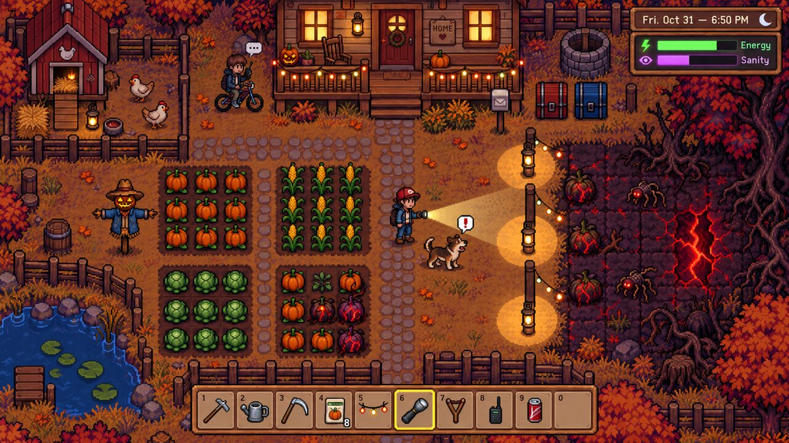
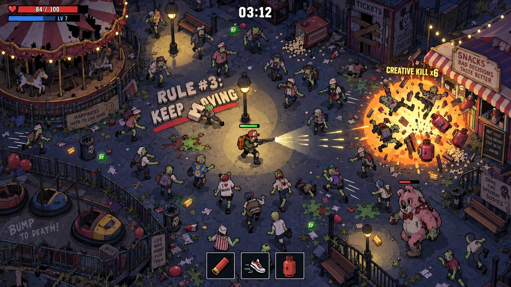
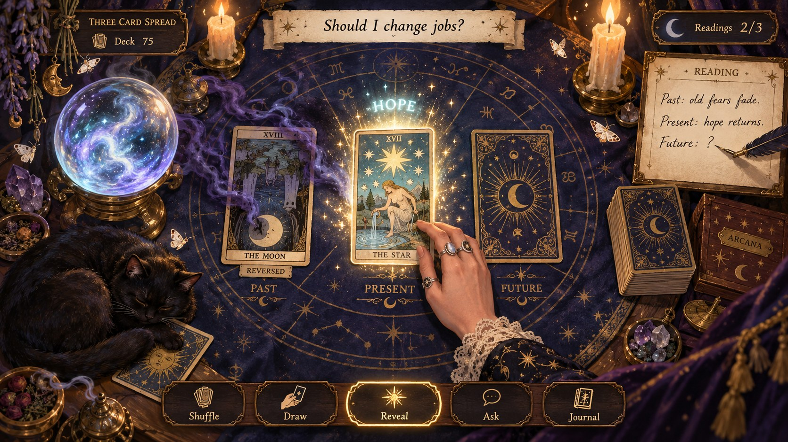
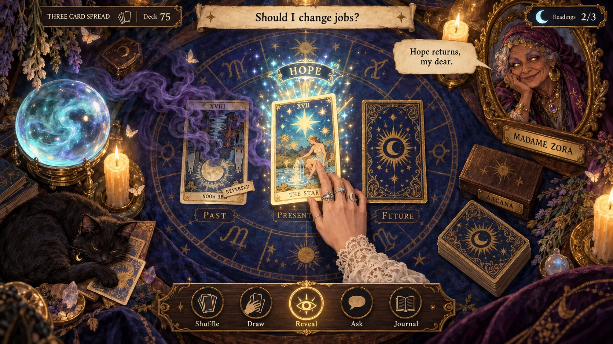
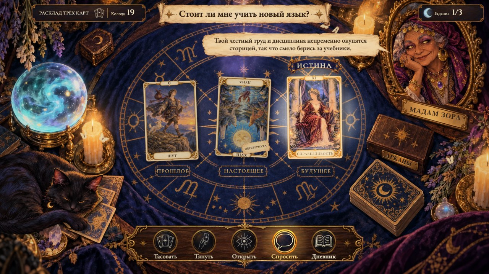
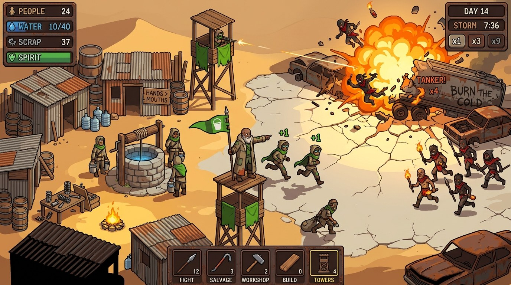
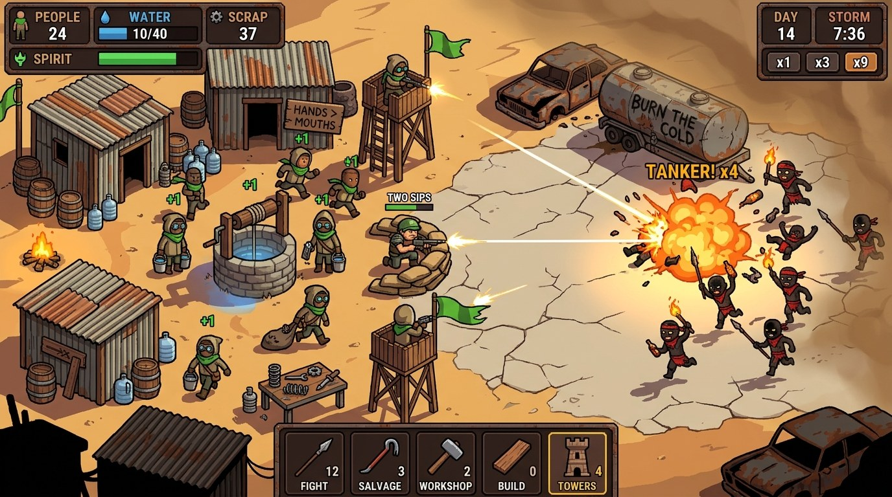
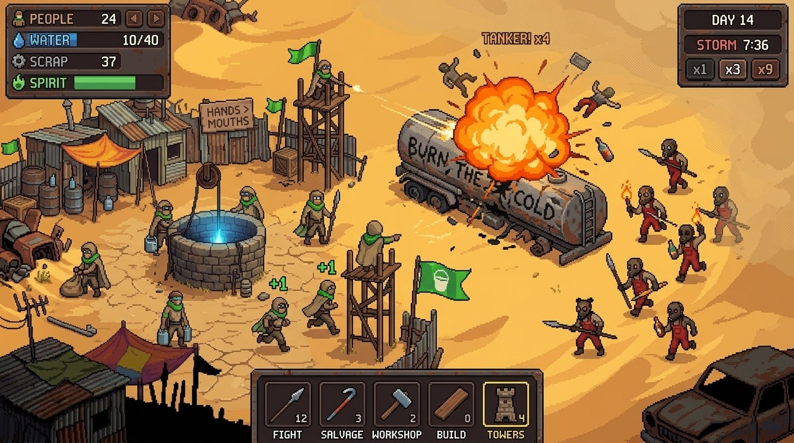
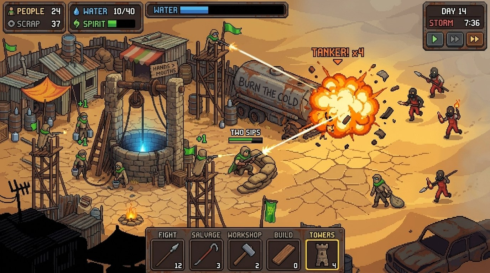

<div align="center">

# game-concept

**A gameplay screenshot of a game that doesn't exist yet**: the reference that
[ref2game](https://github.com/kimvladis/ref2game) turns into a playable slice.

You bring an idea in a sentence or two. You get back a 16:9 frame from a "released" 2D game, with its HUD, and a brief.

**English** · [Русский](README.ru.md)


</div>

## Install in one prompt

Send this prompt to your agent (Claude Code or Codex):

```text
Install the skill game-concept https://github.com/kimvladis/game-concept
```

The repository has two editions of the same skill. Claude Code takes the `claude/` folder, Codex takes the `codex/`
folder. Then send `/game-concept` in Claude Code or `$game-concept` in Codex with your idea, or just say "make a
concept for a game where…".

---

**game-concept** draws a 2D game idea as a frame from a game that has already shipped: 16:9, the gameplay camera, a
HUD, the hero in the middle of the core action. ref2game copies its reference almost one to one (camera, layout,
palette, scale, HUD), so every detail of the frame is an order for the future game. A pretty illustration with no game
in it is a bad concept.

**A concept is a spec you can look at.**

## Two editions

| | `claude/` for Claude Code | `codex/` for Codex |
|---|---|---|
| Image generation | the Antigravity subscription (`agy`) or the paid Gemini API; with neither, you get the prompt | the session's built-in imagegen by default; `agy` and the Gemini API when they are set up |
| Questions | multiple choice with a recommended answer | the Codex input tool, or briefly in chat |
| Two variants | two background runs; you pick when they land | generated side by side and shown before the turn ends |
| Letter check | the agent reads 6–8× crops | a subagent reads the crops blind, without the prompt, when delegation is available |

The prompt template, the checks, `patch.py` and the examples are the same in both.

## How it feels

```text
You      /game-concept  a farmer defends the crops at night with a flashlight
Agent    One question round: the camera, the style, which moment to show.
Agent    Two variants in the background that differ in one open question; side by side, with the slots that came out.
You      The second one, but the HUD needs a day counter.
Agent    One edit, one change. Every label read letter by letter on a 6× crop:
         "ROCKS" came out as "ROCRS", so the box is patched back from the previous version.
Agent    concept/final.png and BRIEF.md are ready. Next: /ref2game with final.png.
```

## The pipeline

| # | Phase | You | The agent |
|---|---|---|---|
| 1 | Ask | answer one round of questions | asks only for the camera, the style and the moment; decides the rest and says what it decided |
| 2 | Prompt | — | fills every slot of the template: camera, style, world, moment, threat, light, HUD, framing |
| 3 | Generate | pick one of two | two variants that differ in one open question, and a slot-by-slot report for each |
| 4 | Edit | ask for changes | one change per edit; labels checked letter by letter; broken text patched back with `patch.py` |
| 5 | Deliver | take `concept/` | `final.png`, `final.prompt.txt` and `BRIEF.md`, which answers ref2game's first questions |

## Image generators

| Generator | What you need | Speed and cost | Output |
|---|---|---|---|
| Codex built-in imagegen (Codex edition only) | Codex | counts against your Codex limits | the size the tool picks; the Codex edition's default |
| Antigravity subscription (`scripts/agy_gen.py`) | `agy` on PATH, signed in | 40–90 s per image; your Google plan's quota, no API key | ~1376×768 |
| Paid Gemini API (`scripts/gemini_image.py`) | `GEMINI_API_KEY` | 15–40 s per image; ~$0.07 per 2K image, ~$0.3–0.5 for a whole concept | 2752×1536, Nano Banana 2.1 |
| Manual | nothing | your time | the agent writes the prompt, you paste it into the Gemini app and drop the image into `concept/` |

Both scripts take the same flags, and the paid one prints the cost of every image. When more than one generator works,
the agent adds the choice to its question round; in Codex, imagegen comes first. The scripts are shared with ref2game,
so the generator you pick carries over.

## What makes it different

- 🎮 **A frame from a shipped game, not a poster.** The camera follows the player, characters are about 1/10 of the
  frame height, the HUD sits in panels at the edges. No title logo, no perspective, no depth of field.
- 🧩 **Every slot is filled.** Camera, style, world, moment, threat, light, HUD and framing, in English, by template.
  An empty slot is a hole in the future game.
- 🔤 **Text is the rules.** Short HUD labels and numbers ("Energy", "84/100", "LV 7", "03:12") are what turn a picture
  into a game. Nano Banana draws them cleanly, so the skill writes them in.
- 🔍 **Letters are checked, not trusted.** An edit re-renders the whole frame and can break text it wasn't asked to
  touch. Every label is read on a 6–8× crop. A broken one is pasted back from the version where it was right:
  `patch.py` refuses if the layout around the box has moved.
- 🛠️ **Buildable by ref2game.** One projection, 3–5 actor types (each one gets a rig), props that stand apart, and only
  effects that code can do: light, particles, flashes, explosions, rain.
- ⚖️ **Variants that answer a question.** Two variants differ in one open choice (style, moment or camera), never two
  random takes of the same prompt.

## What a good concept looks like

The skill measures itself against two frames: the references from the
[ref2game examples](https://github.com/kimvladis/ref2game#examples). ref2game turned each of them into a playable slice.

| A top-down pixel farm at night | A top-down horde shooter |
|---|---|
|  |  |

## Examples

Each concept image comes with its full prompt.

### Madame Zora: from an idea to a live game

A cozy tarot reading simulator: the player types a question, draws cards, and an oracle reads the spread. Two variants
drawn with Codex's built-in image_gen. The open question is whether the oracle herself is on screen.

| The reading is written on a parchment panel | Madame Zora herself: a hero portrait and a speech bubble |
|---|---|
|  |  |
| [prompt](examples/madame-zora-v1a.prompt.txt) | [prompt](examples/madame-zora-v1b.prompt.txt) |

The second variant became the reference for ref2game, and the slice grew into a full game: Madame Zora reads the spread
for your own question and speaks the answer. Play it at **[zora.vladislav.kim](https://zora.vladislav.kim)**.



### Hands > Mouths: colony defence in a post-collapse desert

The player runs a tribe by assigning people to jobs and never selects units. Two rounds of two variants, all four drawn
with the Antigravity subscription (`agy_gen.py`).

In both rounds the open question is the moment: who is the centre of the frame. The HUD carries the rules: people,
water, scrap, spirit, the day, the storm timer, and the jobs as action slots with headcounts.

**Round 1.** The prompt asks for HD pixel art with dark outlines and cel shading; the generator draws a smooth
cel-shaded illustration instead.

| The Elder commands from the well | No single hero: the veteran "TWO SIPS" behind sandbags |
|---|---|
|  |  |
| [prompt](examples/hands-mouths-v1a.prompt.txt) | [prompt](examples/hands-mouths-v1b.prompt.txt) |

**Round 2.** The style slot is rewritten as true HD pixel art: square pixels, a palette of about 32 colours, dithering,
no outlines, with a pixel-art style reference. The raiders get red overalls and welding goggles so they read as red,
not as black silhouettes.

| The Elder commands from the well | No single hero: the veteran "TWO SIPS" behind sandbags |
|---|---|
|  |  |
| [prompt](examples/hands-mouths-v2a.prompt.txt) | [prompt](examples/hands-mouths-v2b.prompt.txt) |

## Try saying

- *"Make a concept for a game where a lighthouse keeper fights off sea monsters"*
- *"Draw a fake gameplay screenshot: a side-view platformer in watercolour"*
- *"How would a cosy fishing roguelike look?"*
- *"I need a reference for /ref2game"*
- *"Change only the HUD: add a day counter"*, inside a running concept

## Requirements

Claude Code or Codex, Python 3.9+ with Pillow and NumPy, macOS or Linux. Codex draws with its built-in imagegen. In
Claude Code, one of these: the Antigravity CLI (`agy`) signed in to a Google account, or a `GEMINI_API_KEY`. With no
generator at all, the agent hands you the prompt.

The skill's instructions are written in Russian. The image prompts it writes are in English.

## Pairs with ref2game

[ref2game](https://github.com/kimvladis/ref2game) turns one picture into a live, playable 2D game. game-concept makes
that picture when all you have is an idea: `concept/BRIEF.md` answers ref2game's first question round, and
`concept/final.png` is the reference.

## License

MIT — see [LICENSE](LICENSE).
